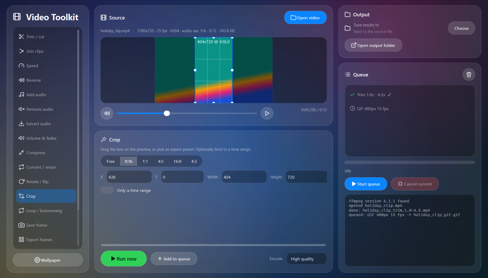

# Video Toolkit

The everyday video jobs, done right, in one window: trim and cut, join, speed, reverse, add or strip audio, volume and fades, compress to a size, convert and resize, rotate, crop, loop and boomerang, save frames, export frames, make GIFs, overlay or replace a region, and contact sheets. Every job is a clean FFmpeg command you can see in the log, run on a worker thread with real progress, and queued so you can line up a batch.



## Tools

| Tool | What it does |
|---|---|
| **Trim / cut** | Keep one range, or several ranges joined into one clip. Precise (frame-accurate re-encode) or Fast (stream copy). Set in/out from the preview. |
| **Join clips** | Concatenate in order. Fast copy when formats match, or re-encode anything (sizes are padded, missing audio is filled). |
| **Speed** | 0.25x to 4x; audio keeps its pitch unless you want the chipmunk effect. |
| **Reverse** | Play backwards, audio included. |
| **Add audio** | Replace the soundtrack or mix a track under it; loops short tracks, fades out at the end. |
| **Remove audio** | Strip the audio without re-encoding (instant). |
| **Extract audio** | MP3, WAV, M4A, FLAC or the original stream. |
| **Volume & fades** | Gain, fade in / out, loudness normalisation (EBU R128). |
| **Compress** | By quality preset, or to a target size (for example 25 MB), optionally capping the height. |
| **Convert / resize** | MP4, MKV, MOV, WebM (VP9), AVI; 360p to 4K; change the frame rate. |
| **Rotate / flip** | 90° either way, 180°, mirror, upside down; clears the rotation tag so players agree. |
| **Crop** | Drag a box on the preview or pick 9:16, 1:1, 4:5, 16:9, 4:3. Optional time range. |
| **Loop / boomerang** | Repeat N times, or forward-then-backward. |
| **Save frame** | The preview frame as PNG or JPG. |
| **Export frames** | One image every N seconds, or every frame, scaled if you like. |
| **Make GIF** | Palette-optimised looping GIF from a range. |
| **Overlay / replace region** | Watermark or picture-in-picture in a corner, or a custom box dragged on the preview. Crop a region out, edit it elsewhere, and drop the result back in the same box with the original audio kept. |
| **Contact sheet** | A grid of evenly spaced frames as one image. |

Also: drag-and-drop (drop several clips to go straight to Join), a frame-accurate scrubber with a live preview, per-job quality setting, a queue with per-job status, cancel, and a log that shows the exact FFmpeg command for every job.

## Install

**Windows exe**: download `VideoToolkit.exe` from the [latest release](https://github.com/PhantomAnas/video-toolkit/releases/latest). You also need **FFmpeg** on your PATH: get a build from [ffmpeg.org](https://ffmpeg.org/download.html) (on Windows, `winget install Gyan.FFmpeg` works), then start the app. FFmpeg is not bundled; the app tells you if it cannot find it.

**From source** (Windows, macOS, Linux):

```
git clone https://github.com/PhantomAnas/video-toolkit
cd video-toolkit
python -m venv .venv && .venv\Scripts\activate      # or: source .venv/bin/activate
pip install -e .
video-toolkit
```

## Use

1. **Open video** (or drop a file anywhere in the window).
2. Pick a tool in the sidebar, set its options; scrub the preview and use *Set start* / *Set end* or drag the crop box.
3. **Run now**, or **Add to queue** several jobs and **Start queue**.

Results are saved next to the source as `name_trim.mp4`, `name_gif.gif` and so on, or into the output folder you choose. Nothing is ever overwritten; a number is appended instead.

### Command line

```
video-toolkit --cli trim movie.mp4 --start 1:05 --end 1:35
video-toolkit --cli cut movie.mp4 --range 0:10-0:20 --range 1:00-1:30
video-toolkit --cli join a.mp4 b.mp4 --reencode
video-toolkit --cli speed clip.mp4 --factor 2
video-toolkit --cli add-audio clip.mp4 --audio track.mp3 --mix --original-volume 0.3
video-toolkit --cli compress clip.mp4 --target-mb 25 --max-height 720
video-toolkit --cli crop clip.mp4 --aspect 9:16
video-toolkit --cli gif clip.mp4 --start 3 --end 6 --width 480
video-toolkit --cli snapshot clip.mp4 --at 12.5
video-toolkit --cli overlay clip.mp4 --file logo.png --position bottom-right --width 200 --opacity 0.8
video-toolkit --cli info clip.mp4
video-toolkit --cli --help
```

## Notes

- Fast trim and Join (copy) cut on keyframes, so a fast trim may start up to a couple of seconds early; use Precise when it matters.
- Reverse and boomerang hold the clip in memory; the app refuses clips over 10 and 5 minutes respectively. Trim first.
- FFmpeg is found on PATH, next to the exe, or via the `VIDEO_TOOLKIT_FFMPEG` environment variable. Without `ffprobe` the app still works (it parses `ffmpeg -i`).

## Development

```
pip install -e ".[dev]"
pytest                      # argument builders (no FFmpeg) and real runs of every tool on a generated clip
pyinstaller toolkit.spec    # builds dist/VideoToolkit.exe
python scripts/screenshot.py
```

Layout: `src/video_toolkit/ops.py` builds the FFmpeg argument list for every tool (pure functions), `runner.py` runs jobs with progress and cancel, `ffmpeg.py` finds and probes, `cli.py` is the command line, and `app/` is the PySide6 front end (`main_window.py`, `panels.py`, `widgets.py`, `theme.py`, `icons.py`, `worker.py`).

## License

MIT. PySide6 is used under the LGPL; FFmpeg is called as an external program.
